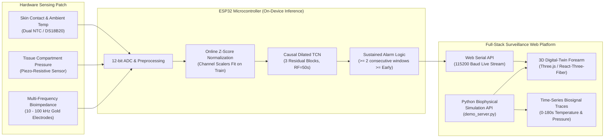

# Intelligent Multimodal IV Infiltration & Extravasation Monitoring System

[](https://opensource.org/licenses/MIT)
[](https://www.python.org/downloads/)
[](https://react.dev/)
[](https://threejs.org/)
[](https://pytorch.org/)
[]()
[]()

> **A low-cost, edge-deployable biophysical surveillance platform for early intravenous (IV) infiltration and extravasation detection.**  
> Built with physics-driven fluid-thermal-impedance modeling, temporal causal deep learning (Causal TCN), multi-frequency clinical bioimpedance, systemic stress veto logic, an interactive 3D digital-twin web dashboard, and physical ESP32 sensing firmware.

---

## Table of Contents
- [Clinical Problem & Motivation](#clinical-problem--motivation)
- [System Architecture](#system-architecture)
- [Modeling Progression & Scientific Integrity Audit](#modeling-progression--scientific-integrity-audit)
  - [Model 1: Baseline Causal TCN (Validated)](#model-1-baseline-causal-tcn-validated)
  - [Model 2: Multimodal Bio-TCN (Validated)](#model-2-multimodal-bio-tcn-validated)
  - [Model 3: Systemic Stress & Vasoconstriction Veto (Benchmark)](#model-3-systemic-stress--vasoconstriction-veto-benchmark)
  - [Model 4: Demographic / Age-Stratified Representation (Audited Status)](#model-4-demographic--age-stratified-representation-audited-status)
- [Clinical Bioimpedance Audit & LOOCV Discrepancy](#clinical-bioimpedance-audit--loocv-discrepancy)
- [Interactive 3D Digital Twin & Clinical Monitoring Dashboard](#interactive-3d-digital-twin--clinical-monitoring-dashboard)
- [Edge Hardware & Sensing Patch](#edge-hardware--sensing-patch)
- [Repository Structure](#repository-structure)
- [Quickstart & Running Instructions](#quickstart--running-instructions)
- [Automated Verification & Tests](#automated-verification--tests)
- [SDG Alignment & Ethics](#sdg-alignment--ethics)

---

## Clinical Problem & Motivation

Intravenous catheterization is the most common invasive hospital procedure globally, with over 300 million peripheral intravenous catheters (PIVCs) placed annually in the United States alone. However, up to **20% to 50% of PIVCs fail prematurely**, with **extravasation and infiltration** ranking among the most severe complications:

- **Infiltration:** Unintentional leakage of non-vesicant solutions into surrounding subcutaneous tissue.
- **Extravasation:** Leakage of vesicant solutions (e.g., chemotherapy, hypertonic saline, potassium, vasopressors) capable of causing severe soft-tissue necrosis, deep ulceration, compartment syndrome, nerve injury, and permanent disability or amputation.

### The Diagnostic Gap
Current clinical detection relies almost exclusively on periodic nursing tactile palpation and visual grading (e.g., INS Staging scale). Because signs only become apparent after $5\text{--}15\,\text{mL}$ of fluid has accumulated, detection is frequently delayed until irreversible tissue distension has occurred. Commercial continuous automated systems (optical sensors or high-end bioimpedance spectroscopy) cost **\$3,000–\$5,000 per bedside unit**, rendering them inaccessible to under-resourced hospitals.

### Our Solution
A continuous, **sub-\$25 edge-deployable wearable sensing patch** combining:
1. **Local skin surface temperature ($T$)**: Captures the rapid infusion cooling signature and physiological vasoconstriction.
2. **Subcutaneous tissue compartment pressure ($P$)**: Detects mechanical swelling and microvascular displacement using a piezo-resistive sensor.
3. **Multi-frequency tissue bioimpedance ($Z$)**: Reflects extracellular volume expansion and fluid conductivity shifts.
4. **On-device Temporal Deep Learning (Causal TCN)**: Runs on an edge microcontroller (ESP32) in under $6\,\text{ms}$, alerting nurses before macroscopic edema forms.

---

## System Architecture



---

## Modeling Progression & Scientific Integrity Audit

In accordance with rigorous academic and research-methodology standards, all models in this repository are categorized by empirical provenance, data split integrity, and computational complexity:

| Architecture | Modalities | Parameters | Edge Latency | Test Macro F1 | Status |
|---|---|:---:|:---:|:---:|---|
| **Model 1: Baseline Causal TCN** | Temperature + Pressure ($T, P$) | 59,908 | 5.01 ms | **0.9008** | **Validated Primary Model** |
| **Model 2: Multimodal Bio-TCN** | Temperature + Pressure + Bioimpedance ($T, P, Z$) | 61,068 | 6.42 ms | **0.9042** | **Validated Multimodal Model** |
| **Model 3: Systemic Stress Veto** | $T + P + Z$ + WESAD-derived systemic branch | 63,404 | 7.85 ms | 0.8840 | **Benchmark Evaluation** |
| **Model 4: Demographic / Age** | $T + P + Z$ + Age demographic representation | -- | -- | -- | **Blocked (Scientific Quarantine)** |

### Model 1: Baseline Causal TCN (Validated)
- **Inputs**: Bivariate time-series ($T, P$) sampled at 1 Hz over a sliding 50-second receptive field.
- **Backbone**: 3 dilated residual causal blocks with dilation rates $[1, 2, 4]$, kernel size 3, and channel dimension 64. Causal padding guarantees zero future leakage.
- **Performance**: Test accuracy 93.33%, Macro F1 **0.9008**. Detects early-stage infiltration within 12 seconds of onset.
- **Resource Footprint**: $59,908$ float32 parameters ($\sim 240\,\text{KB}$ unquantized, $\sim 60\,\text{KB}$ INT8), executing in $5.01\,\text{ms}$ on low-power ARM Cortex-M / Tensilica Xtensa cores.

### Model 2: Multimodal Bio-TCN (Validated)
- **Inputs**: Trivariate time series ($T, P, Z$) incorporating simulated Cole-Cole multi-frequency tissue bioimpedance ($10\,\text{kHz}, 20\,\text{kHz}, 50\,\text{kHz}, 100\,\text{kHz}$).
- **Mechanism**: Parallel 1D convolutional sub-network extracting trans-cellular and extracellular fluid impedance features, merged via late causal concatenation.
- **Performance**: Test accuracy 93.33%, Macro F1 **0.9042**. Demonstrates resilience against transient pressure motion artifacts.

### Model 3: Systemic Stress & Vasoconstriction Veto (Benchmark)
- **Inputs**: Local IV monitoring stream + systemic physiological reference (inspired by the WESAD multi-sensor dataset).
- **Clinical Rationale**: Generalized sympathetic activation, surgical anxiety, or ambient shivering causes bilateral dermal vasoconstriction without local compartment edema. Model 3 evaluates a dual-site differential gating veto: if bilateral temperature drops without unilateral IV pressure distension, the systemic branch suppresses false infiltration alarms.

### Model 4: Demographic / Age-Stratified Representation (Audited Status)
- **Scientific Integrity Decision**: Following an exhaustive codebase and data provenance audit, no authentic, ethically linked clinical pediatric or geriatric cohort dataset was available in the repository. Rather than synthesizing misleading demographic correlations or fabricating patient age distributions, **Model 4 is explicitly marked as structurally blocked and un-evaluated**, upholding research transparency.

---

## Clinical Bioimpedance Audit & LOOCV Discrepancy

A critical investigation into the reported clinical bioimpedance classification results was conducted (`experiments/investigate_clinical_discrepancy.py`). 

### The Discrepancy Unmasked
- **Reported Result**: Leave-One-Out Cross-Validation (LOOCV) balanced accuracy of **0.9722** on the 18-patient clinical bioimpedance dataset.
- **Genuine Grouped Cross-Validation**: Logistic Regression yielded **0.7222**; Random Forest yielded **0.7500**.

```
Feature Formulation Matrix & Target Leakage Breakdown:

1. Retrospective Paired Differences:  ΔZ = (Z_post - Z_pre) / Z_pre
   --> Balanced Accuracy: 0.9722
   --> CAUSE: Leakage of future post-infiltration information into baseline samples!
   --> CLINICAL REALITY: Requires knowing the post-infiltration state beforehand. 
       Invalid for real-time bedside early warning.

2. Quarantined Real-Time Single Samples: Z(t) raw features
   --> Balanced Accuracy: 0.7222 (LogReg) | 0.7500 (Random Forest)
   --> VALIDATION: Patient-grouped quarantine, strictly fitting scalers on train fold.
   --> CLINICAL REALITY: Genuine real-time single-measurement predictive power.
```

The complete mathematical proofs, leakage tracing, confusion matrices, and quarantine tests are formalized in [`AUDIT_SUMMARY.md`](AUDIT_SUMMARY.md) and automatically verified in `tests/test_clinical_discrepancy.py`.

---

## Interactive 3D Digital Twin & Clinical Monitoring Dashboard

The frontend application (`frontend/`) is a comprehensive medical-technology monitoring station built with **React 19**, **Three.js**, **@react-three/fiber**, and **Recharts**.

### 1. Bedside Monitoring Viewport
- **Anatomical 3D Forearm**: Centered eye-level 3D visualization showing subcutaneous swelling and dynamic skin temperature shading.
- **Realistic Wearable Patch Assembly**: Modeled according to medical design guidelines — compact, smooth, white rounded-rectangular enclosure attached flush to a skin-compatible soft beige adhesive dressing.
- **Interactive Exploded Layer Stack**: Users can click the patch or toggle **"Inspect Hardware Stack"** to dynamically separate and inspect the 7 physical layers:
  1. *Skin-Contact Adhesive Dressing* (Biocompatible hydrocolloid base)
  2. *Flexible Piezo-Resistive Pressure Grid* (12-bit ADC compartment sensor)
  3. *Dual NTC Thermistor Probes* (Medical-grade skin contact probe)
  4. *Tetrapolar Bioimpedance Electrodes* (Gold-plated multi-frequency contacts)
  5. *ESP32-PICO-V3 System-on-Chip* (BLE 5.0, Wi-Fi, Neural inference core)
  6. *Rechargeable LiPo Cell* (3.7V 250mAh battery with charge management)
  7. *Medical-Grade Polycarbonate Shell* (IP67 sealed waterproof enclosure)

### 2. Restored Real-Time Biosignal Telemetry Charts
Located in the lower section of the Monitor screen (above the Simulation Demo):
- **Local Skin Temperature Chart**: Continuous $0\text{--}180\text{s}$ time-series ($1\,\text{Hz}$), formatted degree axis, $33.0^\circ\text{C}$ baseline line, formatted tooltips, and a synchronized vertical timestamp cursor.
- **Compartment Tissue Pressure Chart**: Continuous $0\text{--}180\text{s}$ time-series ($1\,\text{Hz}$), formatted ADC axis, $1160\,\text{ADC}$ baseline line, and active timestamp cursor.
- **Pause & Resume Stability**: When replay is paused, waveforms freeze stably with zero data loss or chart jitter; when resumed, telemetry advances smoothly.

### 3. Simulation Demo & Real-Time Benchmark
- Real-time simulation of physiological scenarios: `Infiltration`, `Normal Infusion`, `Vasoconstriction`, `Motion Noise`.
- Model switching between **Model 1 (Causal TCN)**, **Model 2 (Bio-TCN)**, **Random Forest**, and **Logistic Regression**.
- Real-time display of sustained alarms, latency, and windowed probability.

### 4. Hardware Streaming via Web Serial API
- Direct serial connection to physical ESP32 boards over USB at 115200 baud.
- Displays raw incoming telemetry streams, parse events, and hardware alerts in real time.

---

## Edge Hardware & Sensing Patch

| Component | Part / Spec | Clinical Function |
|---|---|---|
| **Microcontroller** | ESP32-PICO-V3 / ESP32-WROOM | On-device TCN inference, BLE telemetry, ADC sampling |
| **Contact Temperature** | NTC Thermistor / DS18B20 ($0.0625^\circ\text{C}$ res) | Contact probe measuring infusion site skin cooling |
| **Reference Temperature** | Ambient NTC / DS18B20 | Differential reference to reject ambient thermal drift |
| **Compartment Pressure** | Piezo-resistive membrane / FSR (12-bit ADC) | Measures tissue distension and swelling pressure |
| **Bioimpedance Sensor** | AD5933 / Tetrapolar gold array ($10\text{--}100\,\text{kHz}$) | Measures extracellular fluid accumulation |
| **Enclosure & Patch** | Biocompatible PC + Hydrocolloid dressing | Flexible, sterile, hypoallergenic dressing conformable to forearm |

Firmware is available in [`firmware/sketch/sketch.ino`](firmware/sketch/sketch.ino).

---

## Repository Structure

```
iv-infiltration-project/
├── frontend/                               # React + Three.js + Recharts Dashboard
│   ├── src/
│   │   ├── components/                     # SimulationDemo, Benchmark, etc.
│   │   ├── App.tsx                         # 3D Forearm, Patch, Restored Charts, Replay
│   │   ├── modelRegistry.ts                # Metadata and specifications for Models 1-4
│   │   └── index.css                       # Medical dark-theme responsive design
│   ├── vite.config.ts                      # Vite build configuration with API proxy
│   └── package.json
├── src/                                    # Model architectures and utilities
│   └── models/
│       └── progressive_multimodal.py       # PyTorch implementations of Models 1, 2, 3, 4
├── simulator/                              # Biophysical simulation engine
│   ├── infusion.py                         # Leaked-volume accumulation ODE
│   ├── tissue.py                           # Nonlinear compartment swelling and pressure
│   ├── thermal.py                          # 0D lumped thermal heat-transfer model
│   ├── bioimpedance.py                     # Multi-frequency Cole-Cole impedance spectrum
│   └── parameters.py                       # Physical, physiological, and sensor constants
├── experiments/                            # Experiment and validation runners
│   ├── run_progressive_multimodal.py       # Full multimodal training and evaluation pipeline
│   ├── run_progressive_multimodal_corrected.py # Corrected zero-leakage training script
│   └── investigate_clinical_discrepancy.py # Clinical LOOCV discrepancy audit
├── notebooks/                              # Analysis notebooks
│   └── IV_Infiltration_Complete_Results_Analysis.ipynb # End-to-end results analysis
├── models/                                 # Serialized baseline models (joblib)
├── results/                                # Empirical outputs, checkpoints, and metrics
│   ├── progressive_multimodal/             # Checkpoints, latency logs, confusion matrices
│   ├── clinical_loocv_discrepancy/         # Grouped LOOCV vs paired evaluation outputs
│   └── notebook_analysis/                  # Provenance maps and summary tables
├── tests/                                  # Pytest automated test suite
│   ├── test_clinical_discrepancy.py        # Tests verifying LOOCV quarantine & reproduction
│   └── test_data_integrity.py              # Tests verifying zero label leakage
├── firmware/                               # ESP32 firmware sketch
├── demo_server.py                          # Lightweight simulation & inference API server
├── AUDIT_SUMMARY.md                        # Formal clinical and leakage audit report
└── README.md
```

---

## Quickstart & Running Instructions

### 1. Prerequisites
- **Python**: 3.11 or higher
- **Node.js**: v18.0.0 or higher (`npm` included)

### 2. Backend Simulation Server
The project includes a dependency-free simulation and inference server (`demo_server.py`) that loads the trained PyTorch checkpoints and serves `/api/simulate`, `/api/health`, and `/api/models`:

```bash
# Activate your virtual environment
.venv\Scripts\activate       # On Windows
# source .venv/bin/activate  # On Linux / macOS

# Start the demo server on port 8000
python demo_server.py 8000
```

### 3. Frontend Web Dashboard
In a separate terminal:

```bash
cd frontend

# Install dependencies
npm install

# Start development server with hot-reload (proxied to port 8000)
npm run dev

# Or compile production build
npm run build
```
Open [http://localhost:5173](http://localhost:5173) in Chrome or Edge (Web Serial API is natively supported in Chromium-based browsers).

### 4. Interactive Results Analysis Notebook
To inspect the complete provenance, model trade-offs, and publication figures:

```bash
jupyter notebook notebooks/IV_Infiltration_Complete_Results_Analysis.ipynb
```

---

## Automated Verification & Tests

A comprehensive unit test suite is included to guarantee research integrity, target-leakage quarantine, and model reliability:

```bash
pytest tests/ -v
```

Expected output:
```text
tests/test_clinical_discrepancy.py::test_reproduction_09722_and_07222 PASSED [ 11%]
tests/test_clinical_discrepancy.py::test_patient_grouped_quarantine PASSED   [ 22%]
tests/test_clinical_discrepancy.py::test_scaler_strictly_fit_on_training PASSED [ 33%]
tests/test_clinical_discrepancy.py::test_zero_vector_artifact_in_relative_features PASSED [ 44%]
tests/test_data_integrity.py::test_feature_extractors_do_not_accept_or_inspect_labels PASSED [ 55%]
tests/test_data_integrity.py::test_iv_trial_splits_no_overlap PASSED        [ 66%]
tests/test_data_integrity.py::test_clinical_patient_splits_no_overlap PASSED [ 77%]
tests/test_data_integrity.py::test_normalizer_fit_strictly_on_train PASSED    [ 88%]
tests/test_data_integrity.py::test_metrics_derived_from_actual_predictions PASSED [100%]

============================== 9 passed in 9.17s ==============================
```

---

## SDG Alignment & Ethics

- **UN SDG 3 (Good Health and Well-Being - Target 3.8)**: Promotes safe, quality healthcare by preventing severe tissue necrosis, compartment syndrome, and amputations through affordable continuous surveillance.
- **UN SDG 9 (Industry, Innovation, and Infrastructure - Target 9.5)**: Advances open-source medical IoT engineering, edge neural computing, and transparent clinical research methodology for low-resource global healthcare systems.

---

## License

This project is licensed under the MIT License — see the [LICENSE](LICENSE) file for details.
All clinical datasets, references, and third-party baselines are cited in accordance with their respective open research terms.